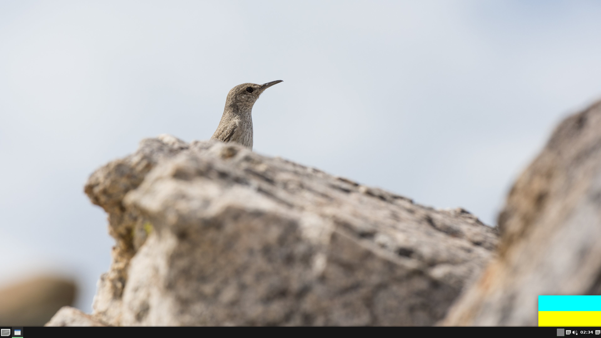
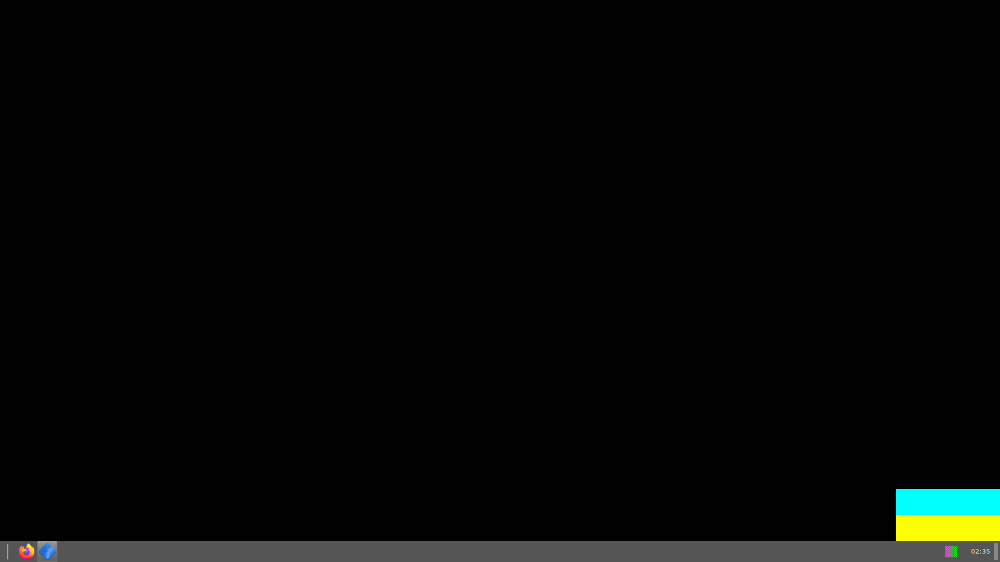
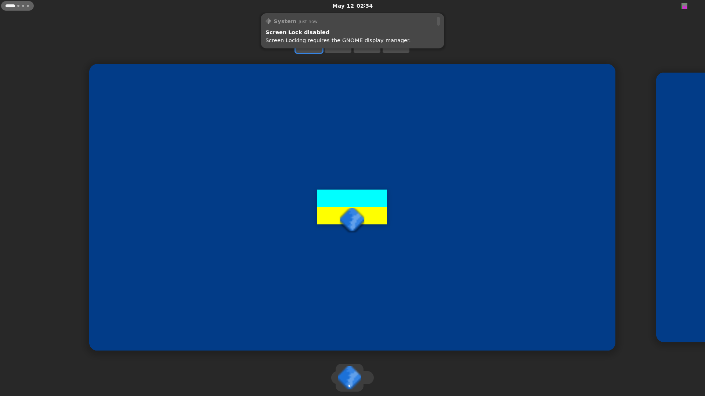
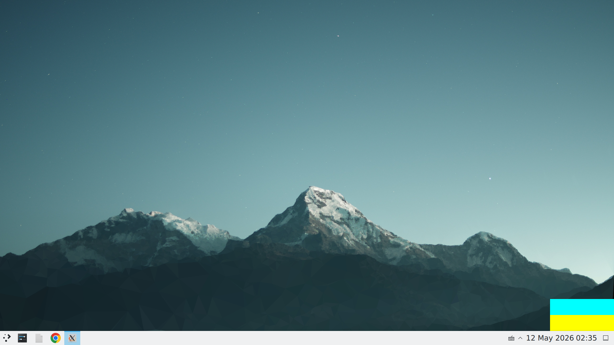
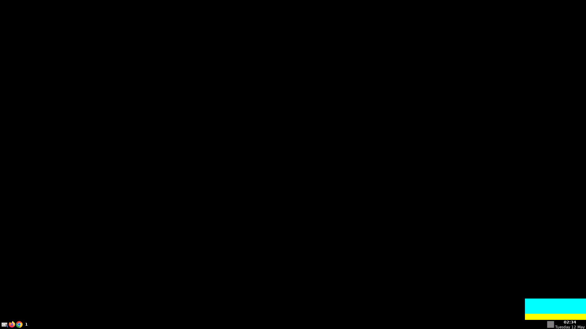
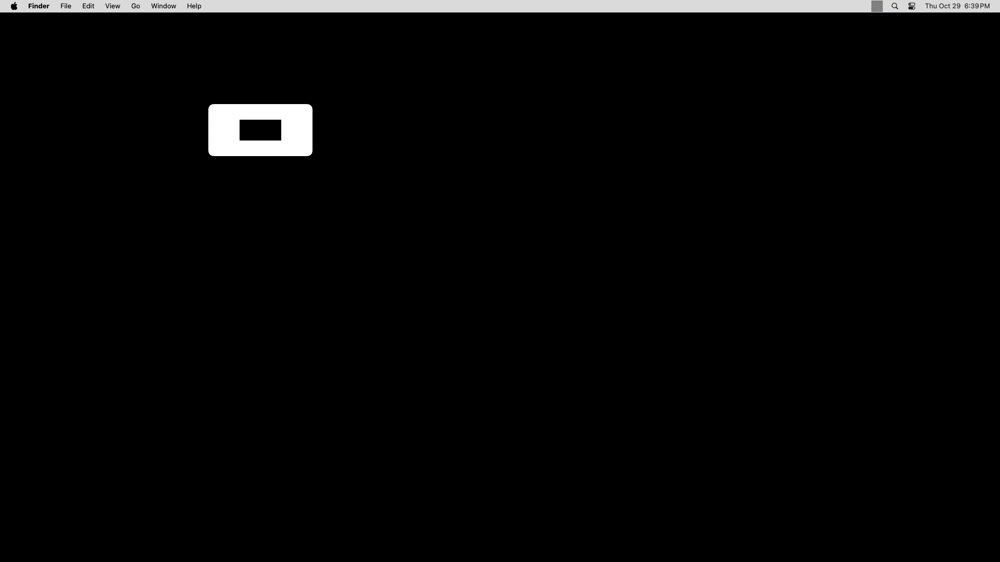
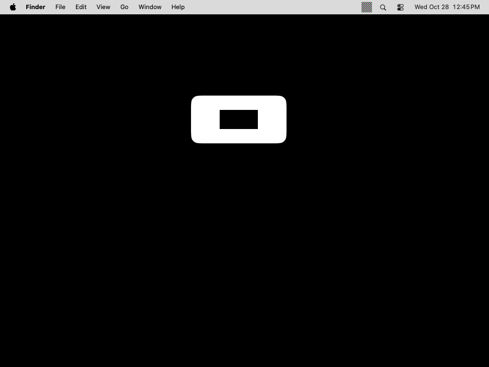
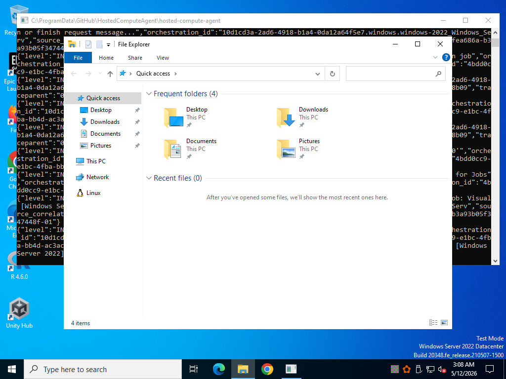
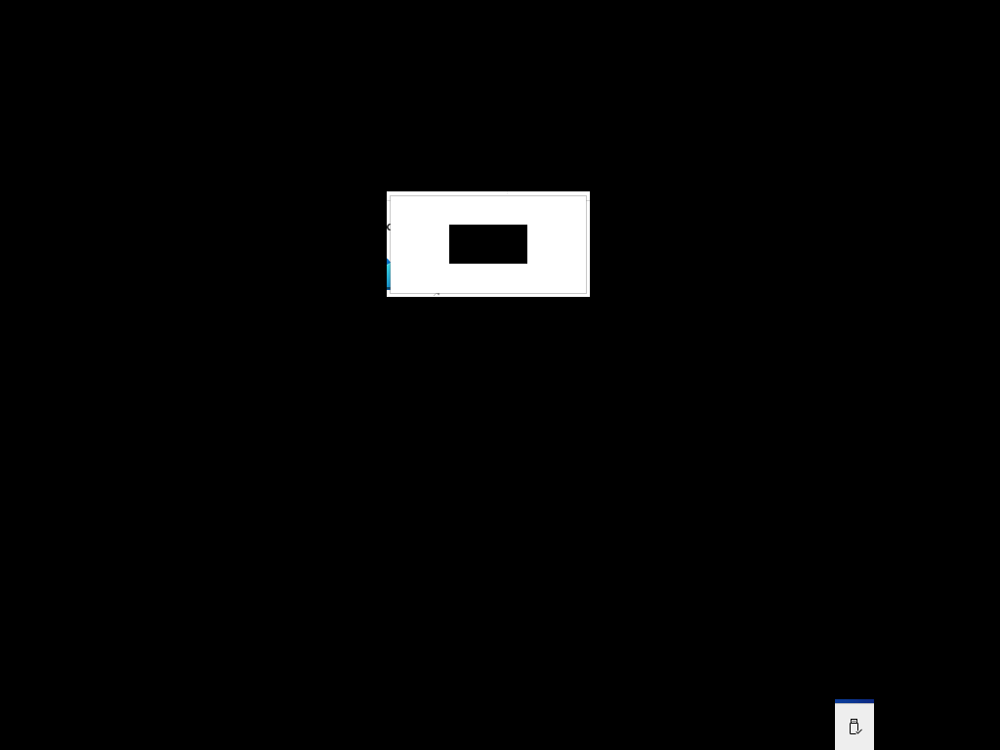

# Platforms where `menubar` is known to work

<!-- platforms:start -->

_Continuously verified by [E2E smoke tests](.github/workflows/e2e.yml)._

| Platform            | Status  |
| ------------------- | ------- |
| macOS 14 (Sonoma)   | ✅ Pass |
| macOS 15 (Sequoia)  | ✅ Pass |
| macOS 26 (Tahoe)    | ✅ Pass |
| Ubuntu 22.04        | ✅ Pass |
| Ubuntu 24.04        | ✅ Pass |
| Ubuntu 26.04        | ✅ Pass |
| Windows Server 2022 | ✅ Pass |
| Windows Server 2025 | ✅ Pass |

<!-- platforms:end -->

## CI runner and lifecycle review

Reviewed 2026-10-24. The E2E and visual matrices use GitHub-hosted runner labels, so an OS can only be added once GitHub publishes its runner label.

- **macOS 27:** `macos-27` is not in GitHub's published hosted-runner list. Do not add it until the label is available; `xcode-27` does not provide a macOS 27 runner.
- **macOS 14 (Sonoma):** The `macos-14` runner remains listed, but Apple does not publish fixed macOS end-of-support dates. Keep it for compatibility for now and review against Apple's security releases; consider removing it when it stops receiving security updates.
- **macOS 15 and 26:** Keep both as supported hosted runners. Apple does not publish fixed end-of-support dates for these releases either.
- **Windows Server 2022:** Mainstream support ended on 2026-10-13, but extended support continues through 2031-10-14. Keep it for compatibility coverage while extended support is acceptable; prefer 2025 for new coverage.
- **Windows Server 2025:** Keep; mainstream support continues through 2029-11-13.
- **Ubuntu 22.04:** Standard maintenance ends in May 2027. Keep for now if older Ubuntu compatibility matters, then remove or explicitly rely on Ubuntu Pro/ESM.
- **Ubuntu 24.04 and 26.04:** Keep; standard maintenance continues through May 2029 and May 2031, respectively.

References: [GitHub-hosted runner labels](https://docs.github.com/en/actions/reference/runners/github-hosted-runners), [Apple security releases](https://support.apple.com/en-us/100100), [Windows Server 2022 lifecycle](https://learn.microsoft.com/en-us/lifecycle/products/windows-server-2022), [Windows Server 2025 lifecycle](https://learn.microsoft.com/en-us/lifecycle/products/windows-server-2025), and [Ubuntu release cycle](https://ubuntu.com/about/release-cycle).

<!-- visual:start -->

_Continuously verified by [visual tray rendering tests](.github/workflows/visual-tray.yml). Each run boots the menubar fixture, screenshots the OS panel, and asserts both the tray icon and the popover window are painted. These checks confirm rendering, not tray-anchored placement. See [Window positioning on Linux](#window-positioning-on-linux)._

| Platform            | Tray + Window | Screenshot                                                                                                                                      |
| ------------------- | ------------- | ----------------------------------------------------------------------------------------------------------------------------------------------- |
| Linux (Budgie)      | ✅ Pass       | 

view

     |
| Linux (Cinnamon)    | ✅ Pass       | 

view

 |
| Linux (GNOME)       | ✅ Pass       | 

view

       |
| Linux (KDE Plasma)  | ✅ Pass       | 

view

           |
| Linux (LXQt)        | ✅ Pass       | 

view

         |
| Linux (MATE)        | ✅ Pass       | 

view

         |
| Linux (Sway/Waybar) | ✅ Pass       | 

view

         |
| Linux (Tint2)       | ✅ Pass       | 

view

       |
| Linux (Xfce)        | ✅ Pass       | 

view

         |
| macOS 14 (Sonoma)   | ✅ Pass       | 

view

             |
| macOS 15 (Sequoia)  | ✅ Pass       | 

view

             |
| macOS 26 (Tahoe)    | ✅ Pass       | 

view

             |
| Windows Server 2022 | ✅ Pass       | 

view

     |
| Windows Server 2025 | ✅ Pass       | 

view

     |

<!-- visual:end -->

## Window positioning on Linux

The checks above confirm that the tray icon and popover window render. They do **not** assert that the popover is positioned next to the tray icon.

On **native Wayland**, tray-anchored positioning is not possible, and there is nothing the library can do about it. Two protocol limitations stack up: an application cannot set the position of its own window (`setPosition` is a no-op, `getPosition` reads back `[0, 0]`), and the tray icon, hosted by the panel via StatusNotifierItem, reports no coordinates. The compositor decides where the popover appears, which is usually the center of the screen. `menubar` logs a one-time warning when it detects the window could not be positioned.

Under **X11 / XWayland**, an application can position its own window, so the popover is placed where `menubar` computes it. (Some Linux panels still report no tray-icon coordinates over StatusNotifierItem, in which case the window falls back to a screen corner rather than sitting exactly under the icon.)

If a Wayland session places the popover in the wrong spot, running under XWayland with `--ozone-platform=x11` restores positioning.
